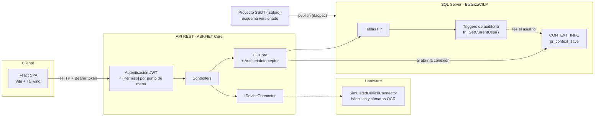

# CILP — Sistema de Gestión y Automatización de Pesajes

Aplicación web para planificar, ejecutar y auditar el pesaje de camiones que ingresan y egresan de una refinería, desde la orden de transporte hasta el ticket de báscula y los reportes de gestión.

Proyecto Final de la carrera de Ingeniería en Sistemas de Información (Universidad Tecnológica Nacional), 2026. Es un proyecto **académico**: no tiene relación ni afiliación con YPF ni con ninguna otra empresa, y todos los datos incluidos son ficticios.

<!-- Reemplazar por una captura o GIF de la aplicación, por ejemplo:  -->
> *Captura de pantalla pendiente.*

## Funcionalidades principales

- **Planificación logística:** autorizaciones de descarga (recepción de crudo) y órdenes de entrega (despacho de refinados), con control de capacidad y reserva de volumen en los tanques.
- **Ciclo de vida de las órdenes:** Planificado, Replanificado (con motivo), Ejecución, Definitivo y Anulado, con reglas de modificación según el estado.
- **Registro de pesadas:** identificación del camión por patente o cámara OCR, lectura automática de báscula o ingreso manual con motivo, tara y bruto según el tipo de orden, tolerancia por producto, cálculo del neto y ticket imprimible.
- **Reportes y Panel de Control:** movimientos por período y por producto, duración promedio de las órdenes, ocupación por báscula e indicadores del día, siempre calculados sobre datos reales.
- **Control de acceso:** inicio de sesión con JWT, roles configurables y permisos por pantalla, aplicados tanto en la API como en la interfaz.
- **Auditoría:** cada alta y modificación registra fecha y usuario de la aplicación.
- **Administración de maestros:** vehículos, conductores, productos, razones sociales, básculas, tanques, puestos, dispositivos de detección, roles y usuarios.

## Stack

| Capa | Tecnologías |
|---|---|
| Backend | C#, ASP.NET Core (.NET 10), Entity Framework Core, autenticación JWT Bearer, OpenAPI |
| Frontend | React 18, Vite, Tailwind CSS 4, React Router, Axios, Lucide |
| Base de datos | SQL Server, proyecto de base de datos SSDT (`.sqlproj`), T-SQL (triggers, funciones, procedimientos) |
| Herramientas | Visual Studio, sqlpackage, sqlcmd, Git y GitHub |

## Arquitectura



## Decisiones técnicas

- **Esquema versionado con SSDT, sin migrations.** La base de datos se define en un proyecto de SQL Server incluido en el repositorio, que es la fuente de verdad del esquema. El backend solo mapea las tablas con Entity Framework Core: no usa migrations ni `EnsureCreated`. La publicación compara el `.dacpac` con la base y aplica las diferencias.
- **RBAC por punto de menú con JWT.** Cada pantalla es un punto de menú, cada rol tiene puntos asignados y un usuario puede tener varios roles. El token incluye los puntos del usuario; la API los exige con el atributo `[Permiso]` (403 si faltan) y el frontend solo oculta lo que el usuario no puede usar.
- **Auditoría por usuario vía `CONTEXT_INFO` y triggers.** Un interceptor de EF Core ejecuta `dbo.pr_context_save` con el ID de red del token en cada apertura de conexión. Los valores por defecto y los triggers leen ese contexto con `dbo.fn_GetCurrentUser()`, de modo que cada registro queda a nombre de la persona y no de la cuenta técnica del servidor.
- **Device Connector detrás de `IDeviceConnector`.** La lectura de básculas y la detección de patentes se abstraen en una interfaz. La versión incluida es un simulador; integrar equipos reales consiste en implementar la misma interfaz y cambiar `Hardware:Modo` en la configuración.
- **Validación de pesadas automáticas contra la lectura de la báscula.** Una pesada se registra como automática solo si el peso coincide exactamente con la última lectura de esa báscula para esa orden, y la lectura se consume al usarse. Cualquier valor tipeado o editado se registra como ingreso manual con motivo obligatorio.
- **Scripts de demo idempotentes.** Los datos de sistema se cargan con `MERGE` en cada publicación, los datos iniciales solo insertan lo que falta y los scripts de demostración pueden ejecutarse repetidamente sin duplicar datos; `reset_demo.sql` devuelve la demo a su estado inicial.

## Inicio rápido

Requisitos: SQL Server (Express o LocalDB), .NET SDK 10, Node.js LTS, `sqlcmd` y Visual Studio con SQL Server Data Tools (o `sqlpackage`). La guía completa, con LocalDB y solución de problemas, está en [Docs/INSTALACION.md](Docs/INSTALACION.md).

1. **Publicar la base de datos:** publicar `Database/Balanza.CILP.DataBase` con el perfil `Balanza.CILP.DataBase.publish.xml`, que crea la base `BalanzaCILP` en `.\SQLEXPRESS`.
2. **Cargar los datos de demostración**, desde la raíz del repositorio:
   ```
   sqlcmd -S .\SQLEXPRESS -E -d BalanzaCILP -f 65001 -b -i Database\Balanza.CILP.DataBase\scripts\testdata\seed_demo.sql
   ```
3. **Configurar y ejecutar el backend**, desde `Backend/` en PowerShell:
   ```powershell
   dotnet user-secrets set "ConnectionStrings:DefaultConnection" "Server=.\SQLEXPRESS;Database=BalanzaCILP;Trusted_Connection=True;TrustServerCertificate=True"
   $b = New-Object byte[] 48; [Security.Cryptography.RandomNumberGenerator]::Create().GetBytes($b); dotnet user-secrets set "Jwt:Key" ([Convert]::ToBase64String($b))
   dotnet run --launch-profile http
   ```
4. **Ejecutar el frontend**, desde `Frontend/`:
   ```
   npm install
   npm run dev
   ```
   La aplicación queda disponible en `http://localhost:5173`.

Usuarios de demostración (contraseña `Demo1234!`):

| Usuario | Acceso |
|---|---|
| `YPF\ADMIN` | Todos los roles y pantallas |
| `YPF\OPERADOR` | Inicio, Gestión de Pesadas y Reportes |

## Estructura del repositorio

```
├── Backend/            API REST en ASP.NET Core
│   ├── Auth/           Atributo [Permiso] y catálogo de puntos de menú
│   ├── Controllers/    Endpoints por recurso
│   ├── Data/           AppDbContext y consultas de pesaje
│   ├── Hardware/       IDeviceConnector y simulador
│   ├── Infrastructure/ Interceptor de auditoría y manejo de errores de FK
│   └── Models/         Entidades mapeadas a las tablas t_*
├── Frontend/           SPA en React + Vite
│   └── src/
│       ├── api/        Cliente HTTP (axios)
│       ├── auth/       Login, sesión y puntos de menú del usuario
│       ├── common/     Componentes compartidos (CrudTable, etc.)
│       ├── features/   Pantallas: dashboard, maestros, pesadas, planificación, reportes
│       └── layout/     Menú lateral y estructura general
├── Database/           Proyecto de base de datos de SQL Server (.sqlproj)
│   └── Balanza.CILP.DataBase/
│       ├── tables/, functions/, storedprocedures/
│       └── scripts/    Datos de sistema, datos iniciales y datos de demostración
└── Docs/               Documentación
```

## Documentación

- [Instalación y configuración](Docs/INSTALACION.md): guía completa, permisos, limitaciones conocidas y solución de problemas.
- [Manual de usuario](Docs/Manual_Usuario_CILP.md): uso de cada pantalla.
- [Especificación funcional](Docs/CUs.md): casos de uso y reglas de negocio.
- [Justificación de tecnologías](Docs/Justificacion_Tecnologia.md): elección del stack y herramientas para la toma de decisiones.
- [Diagrama entidad-relación](Docs/DER.png): modelo de datos. Corresponde a una etapa anterior del diseño y puede no coincidir exactamente con el esquema actual; la referencia vigente es `Database/Balanza.CILP.DataBase/tables`.

## Equipo

| Integrante | GitHub | LinkedIn |
|---|---|---|
| Leonardo Cristalli | [@leogcristalli](https://github.com/leogcristalli) | [LinkedIn](#) <!-- completar --> |
| Marcelo F. Villa Flores | [@villafloresmf](https://github.com/villafloresmf) | [LinkedIn](#) <!-- completar --> |
| Miguel Rodríguez | [@Miguel58000](https://github.com/Miguel58000) | [LinkedIn](#) <!-- completar --> |
